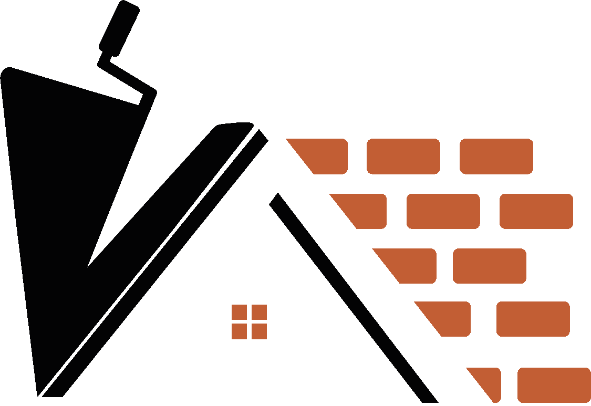
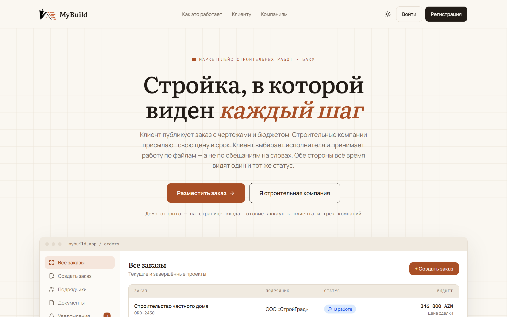
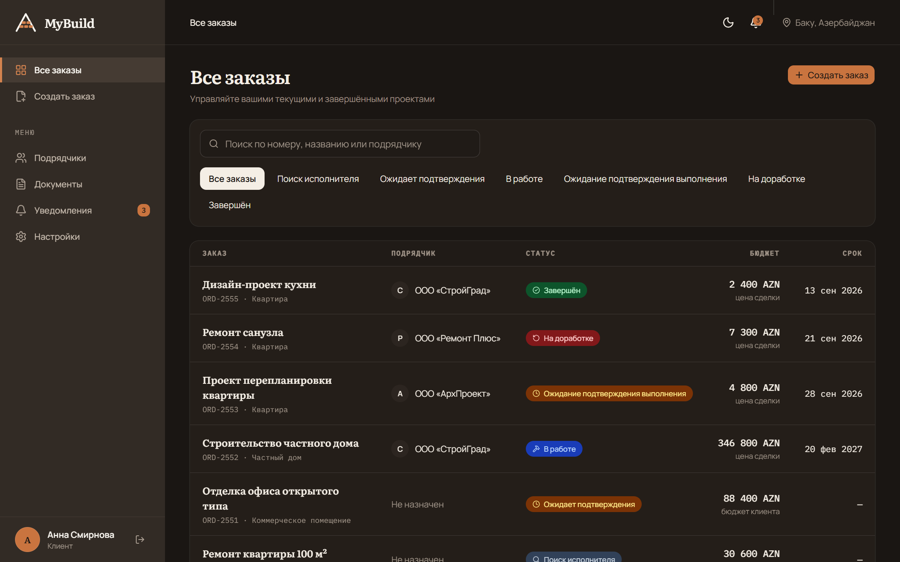
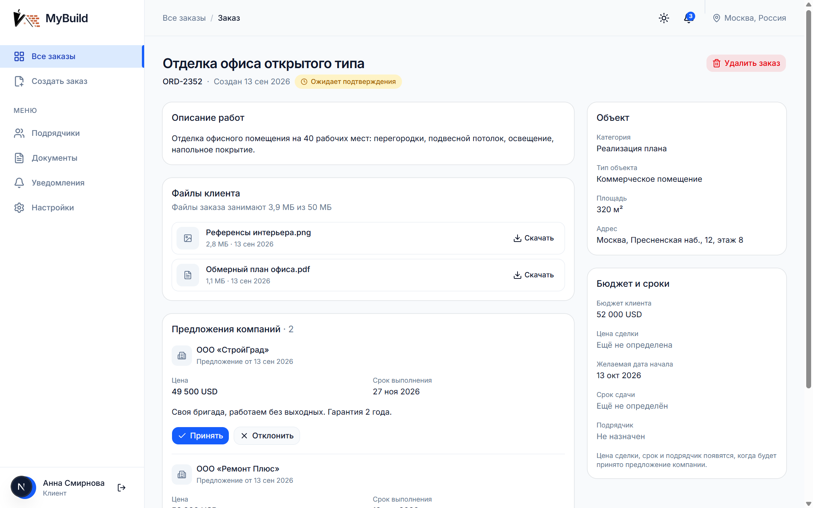
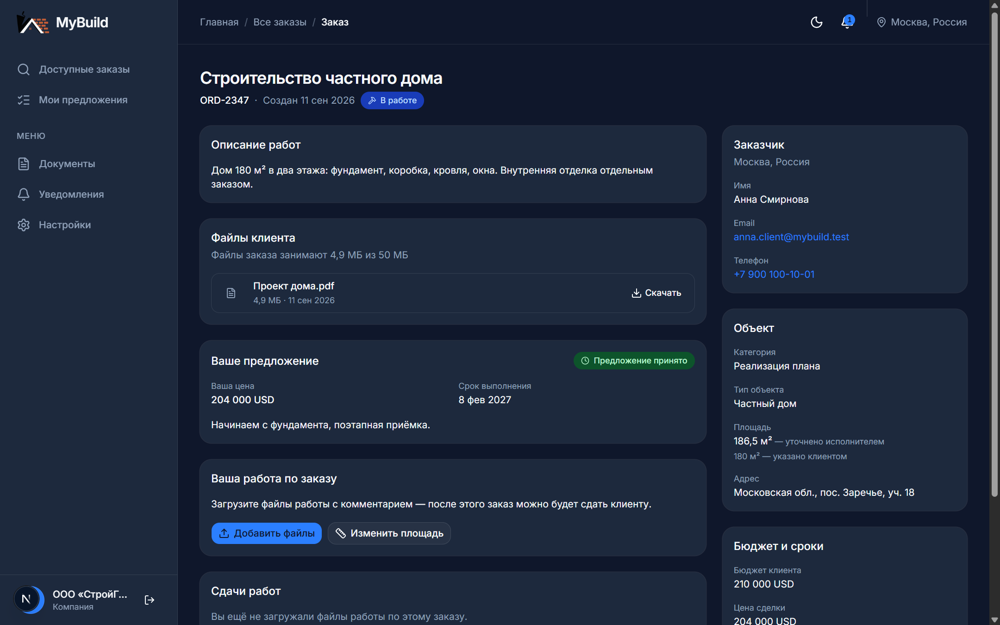
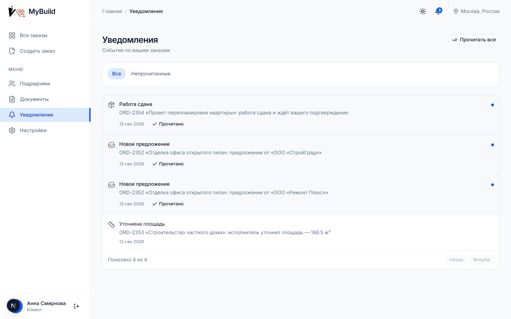
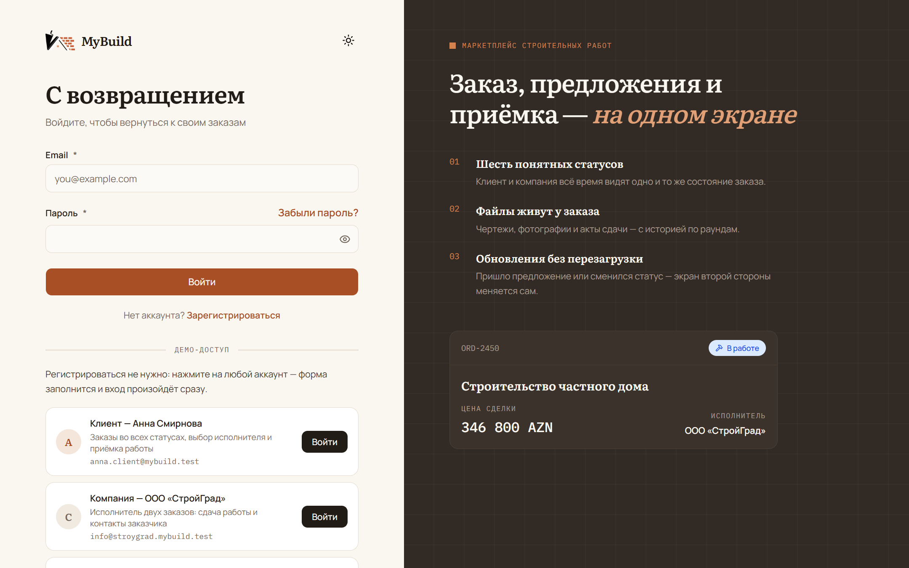

<div align="center">
  

  <h1>MyBuild</h1>

  <p><b>Двусторонний маркетплейс для строительства: клиент публикует заказ, компании предлагают цену и срок, клиент выбирает исполнителя и принимает работу.</b></p>

  <p>
    <a href="https://mybuild.mydigitalhome.me">Живое демо</a> ·
    <a href="#демо">Демо-профили</a> ·
    <a href="#скриншоты">Скриншоты</a> ·
    <a href="#локальный-запуск">Запуск локально</a>
  </p>

  <p>
    
    
    
    
    
    
  </p>
</div>

---

## Что это

В репозитории реализовано автономное демо: полный цикл заказа с доработкой и
приёмкой, документы, каталог компаний, уведомления и редактирование профиля.
Данные и файлы сохраняются в IndexedDB браузера. Backend, Supabase и пароли
для просмотра не нужны. Интерфейс второго этапа принят пользователем;
результаты автоматических проверок и оставшиеся ручные проверки — в
[инструкции проверки демо](docs/autonomous-demo-verification.md).

Публикация этой версии и переключение домена — отдельный следующий этап.
Ссылка на публичное демо пока не подтверждает, что там размещена эта сборка.

MyBuild разработан по реальному заказу клиента. Оригинальную клиентскую версию
нельзя публиковать из-за договорных ограничений. Этот репозиторий содержит
отдельную публичную демонстрационную версию, которая показывает основные
возможности и технические решения проекта.

Демоверсия охватывает полный цикл сделки между заказчиком и строительной
компанией, от публикации заказа до приёмки работы.

- **Клиент** создаёт заказ (категория, тип объекта, площадь, адрес, бюджет, файлы),
  получает предложения с ценой и сроком, выбирает одно, контролирует ход работ,
  принимает результат или возвращает на доработку.
- **Компания** видит ленту заказов вместе с ожиданиями клиента по бюджету, отправляет
  своё предложение, после выбора выполняет работу, прикладывает файлы с комментарием
  и сдаёт на подтверждение.

Ядро — **явная state-машина заказа**: все переходы описаны таблицей, живут в одном
месте и применяются атомарно, вместе с побочными эффектами и уведомлениями.

## Демо

Адрес проекта: <https://mybuild.mydigitalhome.me>. Текущую автономную сборку
до публикации проверяют локально: см. [запуск](#локальный-запуск).

На странице входа выберите один из трёх демо-профилей, без email и пароля:

- **Анна, клиент** — создание заказа, выбор исполнителя, доработка и приёмка.
- **СтройГрад** — предложения, выполнение и сдача работ.
- **Ремонт Плюс** — вторая компания; в её интерфейсе чужие предложения скрыты.

Для полного цикла переключайте профиль в шапке. Все профили одной установки
работают с одним локальным набором данных. Профиль относится к вкладке;
возвращение в другую вкладку обновляет данные. Отдельный браузер, профиль
браузера или другой адрес сайта имеют отдельный мир. Совместной работы между
устройствами и настоящей авторизации здесь нет.

«Выйти» сохраняет изменения. «Начать заново» после подтверждения возвращает
начальный набор и удаляет локально добавленные документы. Автоматического
сброса по расписанию нет. Если хранилище недоступно, можно повторить открытие
или явно продолжить без сохранения; временные изменения исчезнут после F5.

## Скриншоты

Снимки прежней серверной версии показывают дизайн и сценарии; экран входа и
управление демо в текущем коде изменились.

| | |
|---|---|
|  |  |
| **Лендинг** — вход в продукт для обеих ролей | **Заказы клиента** (тёмная тема): статус, подрядчик, цена сделки |
|  |  |
| **Выбор исполнителя** — задание, файлы и предложения компаний; справа — что происходит сейчас | **Заказ у исполнителя**: цена сделки, контакты заказчика, своё предложение |
|  |  |
| **Уведомления** — события по заказам, непрочитанные сверху | **Вход**: демо-аккаунт открывается одной кнопкой |

## Стек

- **Автономное демо:** Next.js 16 (App Router, static export), React 19,
  Tailwind 4, shadcn/ui, IndexedDB.
- **Общее ядро:** TypeScript 6, `@mybuild/shared` — типы, enum-ы, правила
  валидации и чистая state-машина заказа.
- **Сохранённый backend:** NestJS 12, Prisma 7, Supabase Postgres/Auth/Storage,
  Socket.io. Это отдельная серверная реализация; публичное демо её не вызывает.
- **Проверки:** Vitest, fake-indexeddb, Node HTTP smoke, TypeScript,
  oxlint и ESLint. Настоящий IndexedDB и визуальное поведение проверяются вручную.

## Архитектура

```text
Статический хостинг → HTML / CSS / JS / шрифты / пример DXF
                            │
                      Интерфейс браузера
                            │
                    Локальный адаптер данных
                            │
                 Общее ядро @mybuild/shared
                            │
                  Транзакция IndexedDB
                 (сущности и файлы-Blob)
```

- **Одна машина состояний:** frontend и сохранённый backend используют чистую
  функцию из `shared/`; серверная обёртка сохраняет прежние проверки и контракт.
- **Атомарность:** заказ, предложения, документы и уведомления записываются
  одной транзакцией. Ошибка хранения не выдаётся за успешное сохранение;
  зависшая операция ограничена таймаутом. Повторные команды и устаревшие формы
  проверяются до применения изменений.
- **Один локальный мир:** инициализация не перезаписывает существующие данные.
  Повреждённая или несовместимая версия требует явного решения посетителя.
- **Правила видимости:** компания не видит чужие предложения и закрытые поля
  в интерфейсе. Это демонстрация правил продукта, а не защита от владельца
  браузера: все синтетические данные доступны ему через инструменты разработчика.
- **Backend сохранён:** REST, JWT, Prisma-транзакции, Storage и WebSocket остаются
  в `backend/`. Текущий frontend не переключается на него переменной окружения.

### State-машина заказа

| Из | Событие | В |
|---|---|---|
| — | клиент создал заказ | `WAITING` — поиск исполнителя |
| `WAITING` | компания отправила предложение | `AWAITING_CONFIRMATION` — клиент выбирает |
| `AWAITING_CONFIRMATION` | последнее активное предложение отозвано или отклонено | `WAITING` |
| `AWAITING_CONFIRMATION` | клиент принял предложение | `IN_PROGRESS` — цена и срок сделки берутся из предложения, остальные предложения уходят в «не выбрано» |
| `IN_PROGRESS` | компания сдала работу | `AWAITING_COMPLETION_CONFIRMATION` |
| `AWAITING_COMPLETION_CONFIRMATION` | клиент подтвердил | `COMPLETED` |
| `AWAITING_COMPLETION_CONFIRMATION` | клиент вернул на доработку | `COMPLETION_DISPUTED` |
| `COMPLETION_DISPUTED` | компания пересдала работу | `AWAITING_COMPLETION_CONFIRMATION` |

Любой переход вне таблицы — `409 Conflict` с текстом на русском, который можно
показать пользователю как есть. Статус заказа в тексте ошибки не называется:
иначе одним запросом на чужой заказ компания узнала бы то, что прячет весь остальной код.

## Структура репозитория

Один репозиторий, npm workspaces — без Nx и Turborepo: на два приложения это лишняя сложность.

```
backend/      NestJS API — README пакета: backend/README.md
frontend/     Next.js приложение — README пакета: frontend/README.md
shared/       @mybuild/shared: enum-ы, типы API, таблицы переходов
docs/design/  макеты, логотип, презентация продукта
```

## Локальный запуск

Нужны Node.js `^22.12 || >=24` и npm. Версия проекта — в `.nvmrc`.
Команды выполняются из корня репозитория:

```bash
npm run install:demo
npm run build:demo
npm run verify:demo
npm run preview:demo
```

Открыть `http://127.0.0.1:4173`, остановить сервер — `Ctrl+C`.
`install:demo` делает чистую установку shared/frontend без lifecycle-скриптов
backend. `build:demo` собирает shared и Next.js в отдельном каталоге без `.env`;
результат — `frontend/out`. Переменные Supabase, API и WebSocket не нужны.
Google Fonts скачиваются при сборке, готовые шрифты включаются в экспорт и
при просмотре загружаются с того же сайта.

Для разработки: `npm run build:shared`, затем `npm run dev:web` (порт 3000).
Для готового экспорта нужен `preview:demo`, а не `next start`.

### Проверки

```bash
npm run test -w shared
npm run test -w frontend
npm run typecheck -w frontend
npm run lint -w frontend
npm run test:demo-tools
npm run verify:demo
npm run verify:demo:clean
```

`verify:demo` сканирует экспорт, рассчитывает объёмы ресурсов и проверяет HTTP
страниц, файлов и заголовков. Отчёт — `tmp/demo-audit.json`.
`verify:demo:clean` повторяет установку, сборку и HTTP-проверку во временной
копии без backend, Prisma Client и `.env`, затем удаляет копию. Нужен интернет
для npm и шрифтов; отчёт остаётся в `tmp/demo-clean-audit.json`.

Все пакеты, включая сохранённый backend, проверяются после полной установки
зависимостей и локальной генерации Prisma Client:

```bash
npm ci
npm run typecheck
npm run lint
npm test
```

Эти unit-тесты не требуют работающей базы. Серверные `test:e2e`, `db:reset`
и seed — отдельные команды, которые меняют Supabase; для проверки автономного
демо их не запускают. Подробности запуска backend и ограничения его e2e —
в [backend/README.md](backend/README.md).

### Отдельный запуск backend

Для серверной реализации нужны собственный проект Supabase и настройки из
`backend/env.example`. После подготовки базы и Storage по инструкции backend
запускается `npm run dev:api`. Запуск сервера не подключает к нему автономный
frontend. Полноценный переключатель двух режимов в этот проект не входит.

## Размещение статического демо

Подготовленный результат `frontend/out` предназначен для Cloudflare Pages
без Functions. Backend, база, пингер и `next start` при просмотре не нужны.
Публикация и DNS в рамках этапа проверки не выполняются.

В экспорт включён `frontend/public/_headers`: CSP ограничивает загрузки
ресурсами сайта, блокирует внешние соединения и встраивание приложения;
добавлены `nosniff`, запрет индексации и кэширование файлов с хэшем в имени.
Локальный preview применяет используемое подмножество правил `_headers`.
На другом хостинге эти настройки нужно перенести в его HTTP-конфигурацию:
сам файл не настраивает произвольный сервер. Формат описан в
[документации Cloudflare Pages](https://developers.cloudflare.com/pages/configuration/headers/).

CSP разрешает inline-скрипты и стили, необходимые текущему статическому Next.js
и переключению темы. Это ограничение политики: защита от внедрённого
inline-кода ею не обеспечивается. Нет `unsafe-eval` и сторонних runtime-источников.
Проверка применения CSP браузером и измерение LCP описаны в
[ручном чек-листе](docs/autonomous-demo-verification.md).

## Известные ограничения демо

- Данные хранятся только в этом браузере на этом адресе. Очистка данных сайта
  удалит их; резервного копирования и синхронизации нет. Инкогнито может удалить
  данные после закрытия всех его окон.
- Настоящих аккаунтов, email, паролей и совместной работы посетителей нет.
- Ссылка на локально созданный заказ не переносит его в другой браузер.
- Один файл — до 10 МиБ, все пользовательские файлы — до 50 МиБ. Браузер может
  отказать в записи раньше при нехватке места. Встроенный DXF скачивается
  со статического сайта, пользовательские файлы — из IndexedDB.
- Сброс очищает локальные изменения после подтверждения. Повреждённое состояние
  не удаляется автоматически. Из версии данных первого этапа нужен явный сброс.
- Это не PWA и не гарантированный офлайн-режим: для первой загрузки страниц и
  примера документа нужен доступ к статическому хостингу.

## Планируется

Места под это оставлены в схеме и интерфейсе, но в MVP не входят:

- **Платежи** — таблицы `Payment` и `UserCard` в схеме есть, раздел в настройках
  помечен как «скоро»; интеграции с провайдером нет.
- Рейтинги и отзывы о компаниях — сейчас «Подрядчики» это справочник.
- Чат клиент ↔ компания внутри заказа; пока стороны сделки видят контакты друг друга.
- Уведомления на почту и push — сейчас только внутри приложения.
- Пересмотр цены и срока после начала работ.
- OAuth-вход и MFA относятся к отдельной серверной версии, а не к локальному демо.
